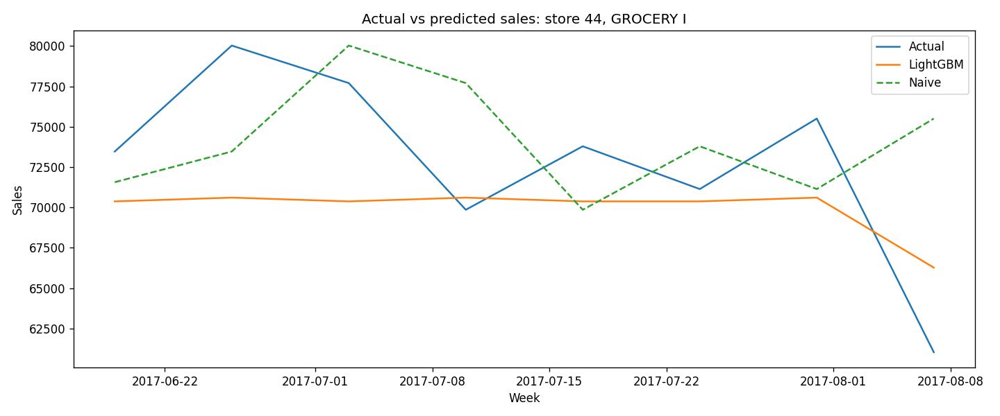
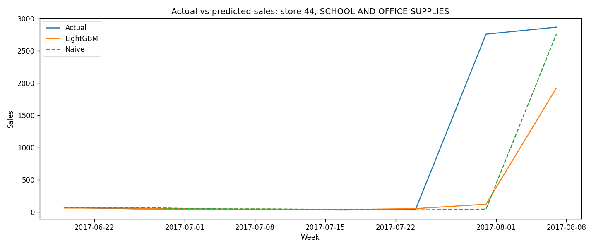

# Retail Sales Forecasting

This project forecasts weekly sales for ~1,700 store × product-family series, 1 week ahead. We compare a LightGBM model against two baselines: naive (next week = this week) and seasonal naive (next week = the same week last year). LightGBM cut error (WAPE) by about 10% versus naive on the final held-out period, though results in the backtest were mixed, and it did worse than seasonal naive over the holidays.

---

## 1. Overview

This project aims to forecast the next week's total sales for each store and product family. We use Kaggle's "Store Sales – Time Series Forecasting" data (Corporación Favorita, Ecuador, Jan 2013 – Aug 2017), which covers 54 stores and 33 product families. With this project, sales could be predicted to help make stocking decisions. Kaggle's `test.csv` has no sales column, so the models are evaluated on held-out periods of the training data.

### Data quirks
- The April 16, 2016 earthquake
- Paydays on the 15th and last day of each month
- No data on Christmas Day (stores closed)
- Promotions not recorded until ~2014

## 2. Method

### Building the weekly table
- Weeks start on Monday; daily sales and promotions summed per store, family and week.
- Dropped 53 store-family series that never had a sale (for example, stores that don’t carry a category), leaving 1,729 series.
- Dropped only the first (6-day) and last (2-day) partial weeks. Kept the 6-day Christmas weeks: stores are closed on Dec 25, so those 6 days are the full selling week, and dropping them would leave gaps in the 52-week lag.
- Joined store info and a national holiday flag. Checked row counts after each merge.
- Left out oil price: the current week's price isn't known at forecast time (leakage), and its slow effect on spending is already reflected in lagged sales.

### Features

| Type | Features |
|---|---|
| Lags | sales 1, 2, and 52 weeks ago |
| Rolling averages | previous 4 and 12 weeks |
| Calendar | month, week of year, holiday week, payday week |
| Promotions | items on promotion |
| Store info | store, family, type, city, state, cluster (categorical) |

1. Lags - sales 1, 2 and 52 weeks earlier, shifted within each store-family series so no row sees its own week or later
2. Rolling averages - previous 4 and 12 weeks shifted so the current week isn't included
3. Calendar - Describe timing and is known in advance
4. Promotions - the number of items on promotion (known in advance, so using won't cause leakage)
5. Store info - categorical variables that give information about the store; don't cause any leakage

### Models
- Naive: next week = this week
- Seasonal naive: next week = same week last year
- LightGBM: default settings, trained on log1p(sales) so that errors count in relative terms and the largest series don’t dominate training, predictions converted back with expm1

### Evaluation
- 3 backtest cutoffs, each trained on everything before and tested on the next 8 weeks.
- A final 8-week test, scored once.
- WAPE because it handles zeros, weights by volume, and is a percentage making comparison easier and MAE is reported alongside it to show the error in units.

| Window | Test weeks |
|---|---|
| Backtest 1 | Sep 5 – Oct 24, 2016 |
| Backtest 2 | Dec 5, 2016 – Jan 23, 2017 |
| Backtest 3 | Mar 6 – Apr 24, 2017 |
| Final test | Jun 19 – Aug 7, 2017 |

---

## 3. Results

### WAPE (lower is better)

| Model | September | December | March | Backtest avg | Final test |
|---|---|---|---|---|---|
| Naive | **8.2%** | 16.5% | 10.2% | **11.6%** | 9.5% |
| Seasonal naive | 13.5% | **13.7%** | 17.3% | 14.9% | 16.0% |
| LightGBM | 8.7% | 17.7% | **9.6%** | 12.0% | **8.6%** |

Bold = best model in each column.

### MAE (units sold per store-family-week)

| Model | September | December | March | Backtest avg | Final test |
|---|---|---|---|---|---|
| Naive | 250.4 | 600.8 | 351.0 | 400.7 | 324.6 |
| Seasonal naive | 409.8 | 500.9 | 595.6 | 502.1 | 547.1 |
| LightGBM | 264.5 | 646.7 | 329.9 | 413.7 | 293.1 |

Overall, for the Final test, LightGBM wins with a WAPE of 8.6%. Outside of the final test, LightGBM only outperforms Naive and Seasonal naive in March, whereas Naive outperforms Seasonal naive and LightGBM with the smallest backtest average with a WAPE of 11.6%.

### Forecast vs actual



LightGBM smooths out the week-to-week swings that naive copies a week late, giving lower error on this series, though it runs consistently a bit low.

### Earthquake flag (tested, not kept)
To account for the earthquake, we added an earthquake binary flag that stated if the week was between "2016-04-11" and "2016-05-09". We used LightGBM along with the flag to test on the backtest periods. The flag improved December, made September slightly worse and left March unchanged. The overall change was too small and inconsistent to count. Thus, the flag was not kept in the final model.

---

## 4. Promotion lift

For the promotion analysis, we summed sales and promotions nationally by family and week, then regressed log(1 + sales) on log(1 + promotions) with family and week fixed effects, clustering standard errors by family. Family fixed effects control for categories being different sizes, and week fixed effects control for holidays, paydays and anything else that lifts all families in the same week. The results showed a 10% increase in promotion activity is associated with about a 2.8% increase in sales (95% CI: 0.1% to 5.4%). The interval is wide because standard errors are clustered by family, so there are effectively only 33 independent groups, and the promotion effect likely varies between families.

### Why this isn't proof of a causal effect
This isn't proof of a causal effect because there could be other confounding variables at play. For instance, stores choose when to promote (for example, during weeks they already expect to be strong, or to boost slow categories) so the estimate could be biased in either direction, and the data can’t show which. In addition, onpromotion measures how widespread promotions were, but not how large the discounts were. In order to figure out a causal effect, there would need to be a randomized test.

---

## 5. Failure cases

### Final-test WAPE by family (largest families)

| Family | Share of sales | LightGBM | Naive |
|---|---|---|---|
| GROCERY I | 29.3% | 8.3% | 9.3% |
| BEVERAGES | 22.6% | 8.1% | 8.6% |
| PRODUCE | 15.0% | 5.1% | 5.3% |
| CLEANING | 8.3% | 16.4% | 19.0% |
| DAIRY | 5.6% | 7.1% | 6.7% |

<!-- Full table: results/final_test_by_family.csv -->

- The results show that on the final test LightGBM beat naive in 30 of 33 families. 
- In the December window, LightGBM (17.7%) did worse than both naive (16.5%) and seasonal naive (13.7%), most likely because there were only two Christmas seasons in its training data, while seasonal naive directly copies last year’s Christmas week.
- Neither LightGBM nor naive anticipated the back-to-school spike in SCHOOL AND OFFICE SUPPLIES. Both reacted a week late, giving about 55% WAPE.
- Tiny families showed very high WAPE but almost no effect on the total (e.g. BOOKS, BABY CARE).
- LightGBM consistently underpredicted Store 44 GROCERY I, one of the largest series, predicting about 70,000–71,000 while actual sales ranged from 70,000 to 80,000.



This plot shows LightGBM and Naive both missing the actual spike and predicting sales a week later.

---

## 6. Limitations and next steps

- Default settings, no tuning for LightGBM
- Earthquake weeks still feed the lags of later weeks
- Promotion estimate is an association
- Only two Christmas seasons in training
- Promotions measure how widespread, not discount depth

Next steps:
- Features for known seasonal events (weeks until Christmas, school start)
- Using seasonal naive for holiday periods, or blending the models

---

## How to run

1. Download the data from the [Kaggle competition page](https://www.kaggle.com/competitions/store-sales-time-series-forecasting/data) (accept the rules first) and unzip it into `data/`.
2. Install packages: `pip install -r requirements.txt`
3. Run the scripts in order:

```
python explore_data.py
python build_weekly_table.py
python features.py
python baselines.py
python train_lgbm.py
python promotion_lift.py
```

Results and charts are saved to `results/`.
